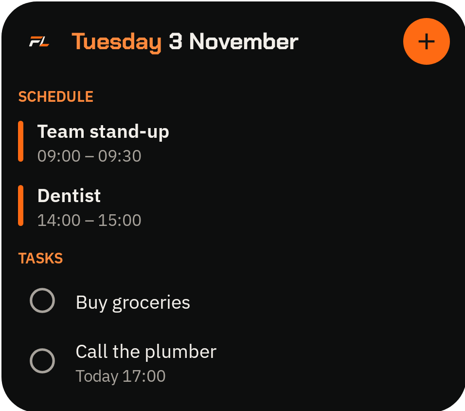

# ForgetLess

An Android calendar, tasks and notes app with alarms that really ring. Everything stays on
the phone: there's no account, no server, and the app has no internet access.



## Features

- **Calendar:** day, week and month views. The month view lists each day's events and tasks.
  It shows public holidays for about 200 countries, offline, plus days from the phone's Google
  holiday calendar such as election days.
- **Tasks:** dates, repeats, steps and pictures. They can be ticked off from the home screen.
- **Notes:** categories, pinning, pictures, PDFs, sharing and voice-to-text.
- **Alarms:** they ring through silent mode and over the lock screen, can be snoozed, and are
  set again after the phone restarts.
- **Widgets:** Today, Calendar, Tasks, Notes and Voice note, with quick-add popups.
- **Themes:** light, dark or your own colours. It works on phones and tablets.

## Built with

- Expo SDK 58, React Native 0.88 and TypeScript, using Expo Router.
- Local SQLite (expo-sqlite).
- An Expo module in Kotlin (`modules/forgetless-device`). It provides the alarms, the alarm
  screen, the widgets' quick-add popup, PDF page rendering and the phone's holiday calendars.
- react-native-android-widget, expo-speech-recognition and date-holidays.

## Running it

Android only. It needs a development build, not Expo Go.

```bash
npm install
npm run check                 # typecheck, lint and tests
npx expo run:android          # debug build on a connected phone
```

For release builds, see [docs/play-store-release.md](docs/play-store-release.md).

## Privacy

See the [privacy policy](https://phillipmarais.github.io/forgetless/privacy-policy.html).

## Licence

[MIT](LICENSE) © Phillip Marais
